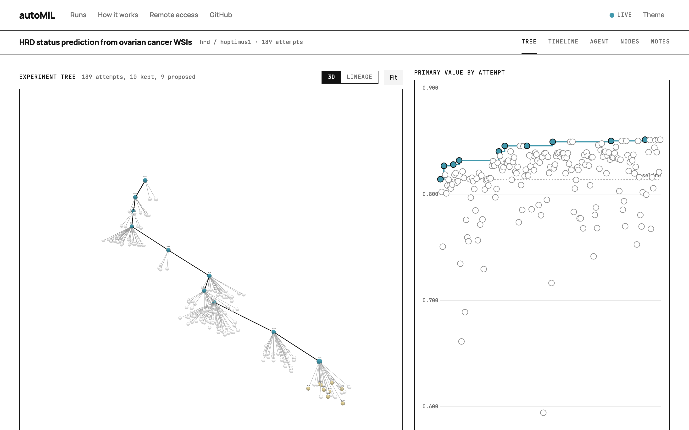
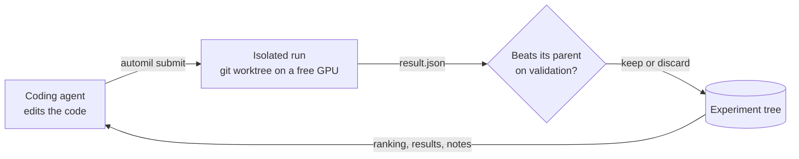
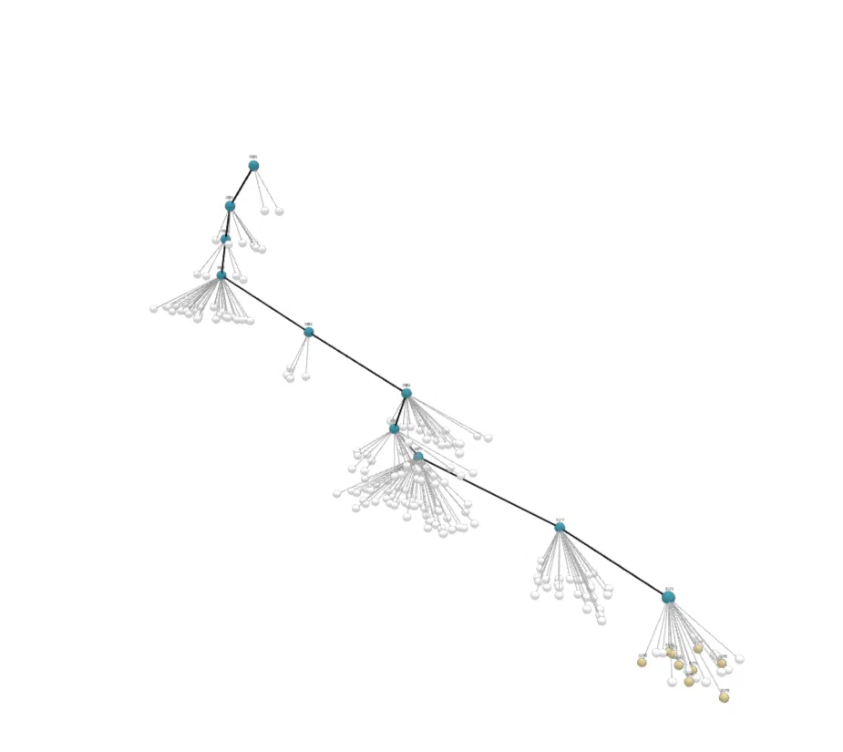
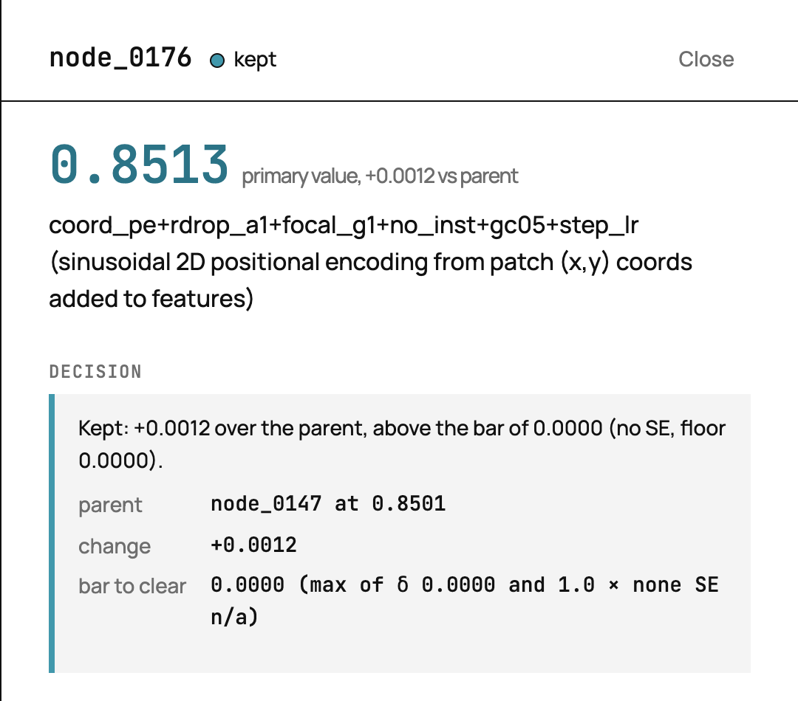
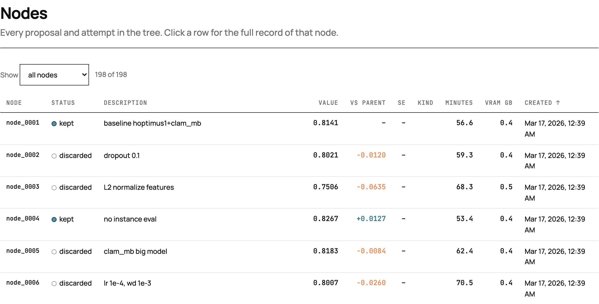
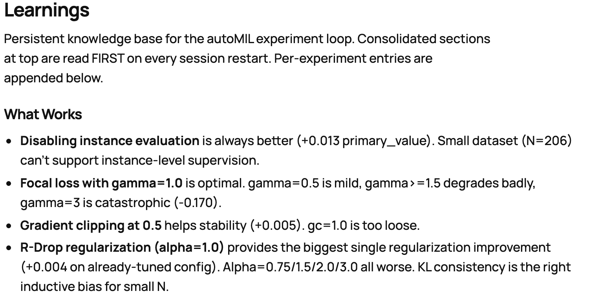

<div align="center">

# autoMIL

### A coding agent runs the experiment loop on your existing ML code base.

It proposes a change, trains it as an isolated experiment, reads the validation
result, keeps or discards the change, and plans the next one. Every attempt,
decision and transcript is recorded.

[](https://github.com/1nslyn/autoMIL/actions/workflows/tests.yml)
[](https://www.python.org/downloads/)
[](LICENSE)
[](https://github.com/astral-sh/uv)
[](https://github.com/1nslyn/autoMIL/commits/main)
<br>
[](docs/getting-started.md#other-runtimes)
[](docs/getting-started.md#other-runtimes)
[](docs/getting-started.md#other-runtimes)

[**Quick start**](#quick-start) ·
[**How it works**](#how-it-works) ·
[**Dashboard**](#the-dashboard) ·
[**Documentation**](#documentation) ·
[**Benchmarks**](benchmarks/README.md) ·
[**Citation**](#citation)

<br>

<picture>
  <source media="(prefers-color-scheme: dark)" srcset="docs/assets/dashboard-tree-dark.png">
  
</picture>

<sub>A recorded run on ovarian cancer HRD prediction: 189 attempts, 10 kept, primary metric from 0.814 to 0.851.</sub>

</div>

## Why autoMIL

Most ML research time goes into one loop: change the code, train, compare,
decide, repeat. Hyperparameter tools such as Optuna search a fixed set of knobs
inside a fixed pipeline. autoMIL hands the whole loop to a coding agent. The
agent edits the source itself (model, loss, training recipe), and autoMIL makes
every edit an experiment that is isolated, scheduled, scored and recorded.

autoMIL was built for Multiple Instance Learning on whole-slide pathology
images. The framework itself only needs a training script that writes a
`result.json`, in any language and with any ML library.

## Highlights

<table>
<tr>
<td width="50%" valign="top">

**The agent edits real code.** It reads your repository and changes any file
you allow: architecture, loss, augmentation, optimizer, schedule. Changes that
touch shared library code ship as registered variants that can be reproduced
later.

</td>
<td width="50%" valign="top">

**Every attempt runs in isolation.** Each submit stores only the changed files.
The orchestrator checks out the base commit in its own git worktree, overlays
the changes, and packs runs onto free GPUs. CUDA, ROCm and CPU all work.

</td>
</tr>
<tr>
<td valign="top">

**Decisions use validation data only.** The framework recomputes the score from
the validation metrics. A change is kept only if it beats its parent by a
margin that accounts for fold-to-fold noise. Test metrics are sealed and
revealed once, with `automil certify`, after the search ends.

</td>
<td valign="top">

**Everything is recorded.** The experiment tree, every result, the agent's
transcript, its plan and its notes are kept on disk. The dashboard shows them
live, and `automil viz export` writes the whole run as a static website.

</td>
</tr>
<tr>
<td valign="top">

**The search has a budget.** Each cell gets a time budget, counted as the
agent's active time or as wall-clock time, and an optional cap on the number of
launched experiments. Runs stopped by the budget still report a partial result.

</td>
<td valign="top">

**It runs where you already train.** Use any coding agent (Claude Code, Codex,
OpenCode, or DeepSeek through either). Run experiments on a local machine, on
SLURM, or on Ray.

</td>
</tr>
</table>

## How it works



1. The agent edits files and runs `automil submit`. autoMIL stores only the changed files.
2. The orchestrator checks out the base commit in a git worktree, overlays the changed files and runs your training script on a free GPU or CPU slot.
3. Your script writes `result.json`. autoMIL recomputes the score from the validation metrics and ignores the value the script reports.
4. The attempt is kept only if it beats its parent by a margin. The margin is the larger of a fixed threshold and the standard error of the per-fold differences.
5. The tree ranks the open branches. The agent reads the ranking, the results and its own notes, and plans the next change.

## Quick start

**1. Install the CLI.**

```bash
uv tool install git+https://github.com/1nslyn/autoMIL.git
```

**2. Add autoMIL to your project and let the agent configure it.**

```bash
cd /path/to/your/project        # any git repository
automil init                    # creates automil/ and installs the Claude Code skills
claude                          # then type: /automil-setup
```

`/automil-setup` reads your code, fills in `automil/config.yaml`, checks that
your training script follows the contract and trains a baseline. To configure by
hand, edit `automil/config.yaml` and run `automil check`.

**3. Start the loop.** Run each command in its own tmux window.

```bash
automil orchestrator start      # GPU scheduler; keep it running
automil viz start               # dashboard at http://localhost:8420

# The default budget mode (cap.mode: agent_active) reads Claude's own
# active-time counter, which Claude exports only when started like this:
CLAUDE_CODE_ENABLE_TELEMETRY=1 OTEL_METRICS_EXPORTER=prometheus \
OTEL_METRICS_INCLUDE_SESSION_ID=true OTEL_EXPORTER_PROMETHEUS_PORT=9464 \
claude --dangerously-skip-permissions   # then type: /automil
```

**4. Watch it work** with `automil status`, `automil rank` or the dashboard.

For Codex, OpenCode or DeepSeek, run `automil init --runtime codex` (or
`opencode`, `deepseek-via-opencode`, `deepseek-via-codex`); see
[Other runtimes](docs/getting-started.md#other-runtimes).

## The dashboard

`automil viz start` serves a site with five views of the run: the experiment
tree with the score of every attempt, a timeline of what the agent did and
when, the agent's full transcript, a table of every attempt with its record,
and the agent's plan and notes.

<table>
<tr>
<td width="50%" valign="top">

<p align="center"><sub><b>Tree.</b> Every attempt and its parent. Kept attempts are blue, open proposals yellow.</sub></p>
</td>
<td width="50%" valign="top">

<p align="center"><sub><b>Record.</b> What changed, the score, and why it was kept or discarded.</sub></p>
</td>
</tr>
<tr>
<td valign="top">

<p align="center"><sub><b>Nodes.</b> Every proposal and attempt, with its score and its change from the parent.</sub></p>
</td>
<td valign="top">

<p align="center"><sub><b>Notes.</b> The agent's own record of what worked and what failed.</sub></p>
</td>
</tr>
</table>

The dashboard binds to `127.0.0.1`. Over SSH, `automil viz start` prints the
port-forwarding command to run on your laptop.

## The training-script contract

Your script reads its settings, trains, and writes `result.json` to its working
directory before it exits. `metrics` holds validation metrics only; test metrics
go in `held_out`, which the agent never sees during the search:

```json
{
  "status": "completed",
  "metrics": {"val_auc": 0.87, "val_bacc": 0.81},
  "held_out": {"test_auc": 0.87, "test_bacc": 0.83},
  "primary_value": 0.84
}
```

The only required field is `primary_value` (higher is better). The script must
also write a partial result when it receives `SIGTERM`, so a run stopped by the
budget still counts. The full specification, including per-fold results and the
environment variables autoMIL sets, is in the
[training-script contract](docs/training-script-contract.md).
[`examples/sklearn-iris`](examples/sklearn-iris/) is a complete consumer in
about 130 lines.

## Examples

| Example | Task | What it shows |
| --- | --- | --- |
| [`sklearn-iris`](examples/sklearn-iris/) | Iris classification, scikit-learn, CPU | The smallest complete consumer of the contract |
| [`ovarian_hrd`](examples/ovarian_hrd/) | HRD prediction from whole-slide images, CLAM-MB | A 189-attempt autonomous run with its tree and notes (shown above) |
| [`clwd`](examples/clwd/) | 7-class lung subtyping | A multi-class project layout |
| [`placeholder`](examples/placeholder/) | | The template `automil init` creates |

## Benchmarks

[`benchmarks/`](benchmarks/) holds **autobench**, a MIL benchmark suite for
computational pathology built on autoMIL. It runs four MIL aggregators (CLAM,
nnMIL, ABMIL, DTFD) and a TITAN slide-encoder arm over three tile encoders on
TCGA and CPTAC cohorts, then gives every cell the same agent budget. See the
[benchmark README](benchmarks/README.md) and its
[tutorials](docs/tutorials/).

## Documentation

| Guide | What it covers |
| --- | --- |
| [Getting Started](docs/getting-started.md) | Setup, configuration, scoring, budgets, backends, the dashboard, other runtimes |
| [Training-Script Contract](docs/training-script-contract.md) | What your script reads and writes, SIGTERM handling, per-fold results |
| [Benchmark tutorial](docs/tutorials/benchmark_experiments_tutorial.md) | Running the autobench grid on a dataset |
| [Feature extraction](docs/tutorials/tcga_feature_extraction_tutorial.md) | Extracting TCGA and [CPTAC](docs/tutorials/cptac_feature_extraction_tutorial.md) slide features with TRIDENT |
| [CHANGELOG](CHANGELOG.md) | Release notes |

Run `automil --help` for every command, and `automil <command> --help` for its options.

## Development

This repository is a uv workspace with two packages: `automil`
([`src/automil/`](src/automil/)) and `autobench`
([`benchmarks/src/autobench/`](benchmarks/src/autobench/)).

```bash
git clone https://github.com/1nslyn/autoMIL.git && cd autoMIL
uv sync --all-packages
uv run pytest tests/ -q                 # framework tests
uv run pytest benchmarks/tests/ -q      # benchmark tests (run from the repo root)
```

CI runs the framework tests on Python 3.10, 3.11 and 3.12, the benchmark tests,
and a build check on every pull request. Bug reports and pull requests are
welcome on the [issue tracker](https://github.com/1nslyn/autoMIL/issues).

## Citation

If you use autoMIL in your research, please cite it:

```bibtex
@software{yin2026automil,
  title  = {autoMIL: Autonomous Agent-Driven Multiple Instance Learning for Computational Pathology},
  author = {Yin, Shuolin and Seo, Yeonwoo and Ma, Jun},
  year   = {2026},
  url    = {https://github.com/1nslyn/autoMIL}
}
```

## Acknowledgements

autobench builds on [CLAM](https://github.com/mahmoodlab/CLAM),
[TRIDENT](https://github.com/mahmoodlab/TRIDENT),
[DTFD-MIL](https://github.com/hrzhang1123/DTFD-MIL),
[AttentionDeepMIL](https://github.com/AMLab-Amsterdam/AttentionDeepMIL) and
[nnMIL](https://arxiv.org/abs/2511.14907), vendored under [`benchmarks/lib/`](benchmarks/lib/) with their original
licenses. The dashboard uses [3d-force-graph](https://github.com/vasturiano/3d-force-graph),
[three.js](https://threejs.org) and [D3](https://d3js.org).

## License

Apache 2.0. See [LICENSE](LICENSE).
